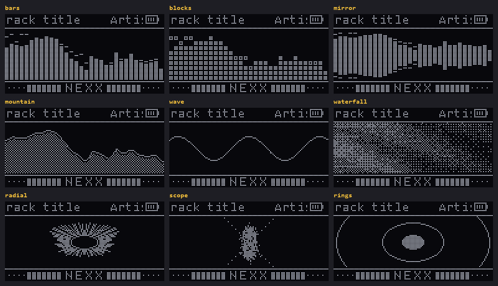
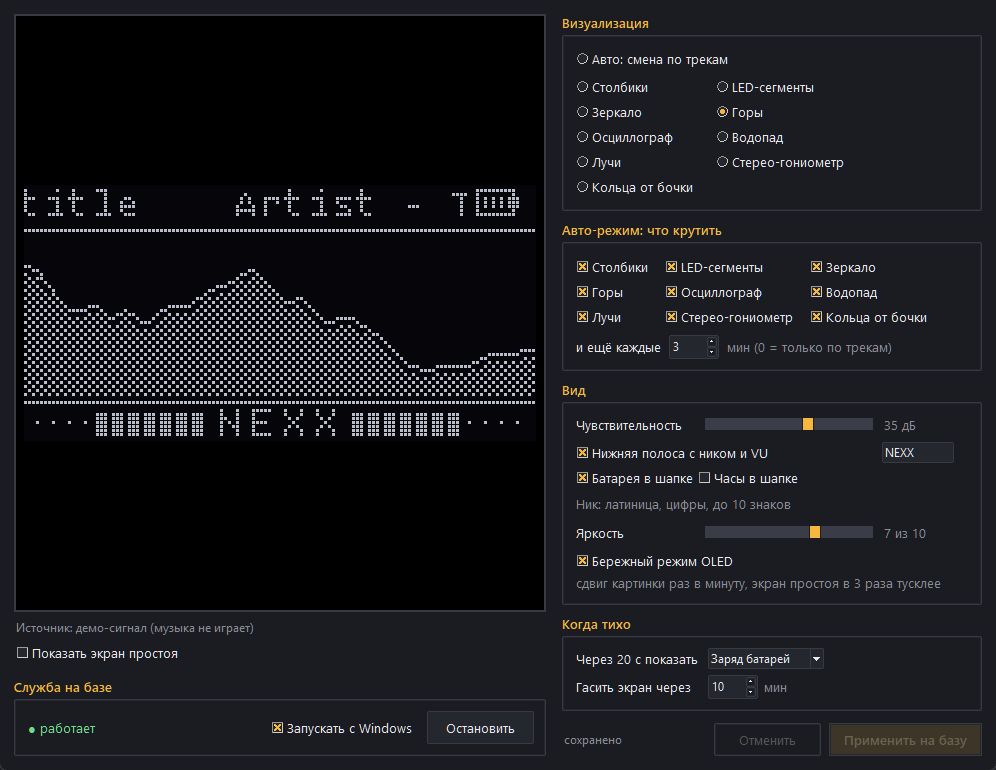

# Arctis Nova Pro OLED visualizer

Turns the 128×64 OLED on the **SteelSeries Arctis Nova Pro** base station into a music display for Windows:
a real-time spectrum analyzer of what you hear, now-playing title, headset and spare battery, volume overlay.
Comes with a settings app that shows a live preview before anything changes on the base.





## Features

- **9 visualizations**: bars, LED blocks, mirror, mountain, oscilloscope, waterfall spectrogram, radial,
  stereo goniometer, kick-triggered rings — or **Auto**, which switches style on every new track.
- Listens to the **actual Arctis output** (WASAPI loopback, after Sonar EQ), not the default device.
- **Now playing** from any app that reports to Windows media controls (Spotify, YouTube Music, browsers…).
- Headset + spare **battery**, volume-wheel overlay, idle screen (batteries / big clock / blank).
- **Brightness** and an **OLED care** mode: pixel shift every minute, idle screens dimmed, screen off after N minutes.
- Settings apply on the fly (no restart), autostart with Windows, the stock base UI comes back when the app stops.

## Requirements

- Windows 10/11, Python 3.12 (tested; `winsdk` has no wheels for some newer versions)
- Arctis Nova Pro **Wireless** — tested. Wired / Xbox variants use the same protocol and are listed, but untested.
- SteelSeries GG / Sonar may keep running.

## Install

```powershell
git clone https://github.com/Nexus-Nexx/arctis-nova-pro-oled.git
cd arctis-nova-pro-oled
powershell -ExecutionPolicy Bypass -File .\install.ps1
```

The script creates `.venv`, installs `requirements.txt`, adds an **Arctis OLED** shortcut to the desktop
(settings app) and a startup shortcut for the display service, then starts it.

Manual run: `.venv\Scripts\pythonw.exe spectrum.py` (service) and `.venv\Scripts\pythonw.exe settings.py` (settings).
Stop: `.\stop.ps1` — the base returns to its stock screen.

## Settings

Everything lives in `config.json` (created by the settings app, re-read every 2 s):

| key | default | meaning |
|---|---|---|
| `style` | `bars` | `bars` `blocks` `mirror` `mountain` `wave` `waterfall` `radial` `scope` `rings` `auto` |
| `auto_styles` | `[]` | styles used by `auto` (empty = all) |
| `auto_minutes` | `3` | `auto` also switches every N minutes (0 = only on track change) |
| `range_db` | `35` | dynamic range of the spectrum; lower = punchier |
| `brightness` | `7` | 1–10 |
| `oled_care` | `true` | pixel shift every minute, idle screens at 1/3 brightness |
| `strip`, `strip_text` | `true`, `NOVA PRO` | bottom strip with stereo VU and a short text (A–Z, 0–9) |
| `show_battery`, `show_clock` | `true`, `false` | header items |
| `idle` | `battery` | after 20 s of silence: `battery`, `clock` or `blank` |
| `blank_after_minutes` | `10` | screen off after this much silence |
| `fps`, `shift_minutes` | `30`, `3` | frame rate; pixel-shift period when OLED care is off |

The settings app UI is in Russian for now.

## How it works

`oled.py` talks to the base over HID feature reports (interface 4, usage page `0xFFC0`), sending the frame as
two 64-column chunks. Volume and battery events are read from the `0xFF00` collection. `spectrum.py` captures
the Arctis loopback with PyAudioWPatch, runs a 2048-point FFT into 32 log-spaced bands with auto-gain,
renders with Pillow and pushes ~30 frames/s.

## Credits and license

The HID protocol (drawing, brightness, events) comes from [JerwuQu/ggoled](https://github.com/JerwuQu/ggoled),
licensed GPL-3.0, so this project is **GPL-3.0** too.
Not affiliated with or endorsed by SteelSeries. Use at your own risk.

---

**RU.** Спектроанализатор, текущий трек и заряд батарей на OLED-экране базы Arctis Nova Pro под Windows.
Установка: `install.ps1`, настройки через ярлык «Arctis OLED» на рабочем столе. Проверено на Nova Pro Wireless.
